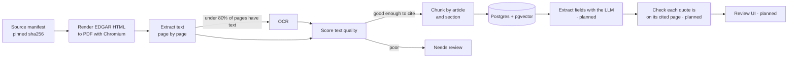

# Fund Document Extractor

Turns fund documents, starting with Limited Partnership Agreements, into validated, typed data. Every extracted fact (management fee, carried interest, hurdle, investment period, key person, clawback) comes with the page it's on and a verbatim quote from that page. A value whose quote can't be found on its cited page is never accepted: it goes to a human reviewer.

TypeScript · Node 22 · Express · PostgreSQL + pgvector · Drizzle · Effect · unpdf · tesseract.js · OpenAI

> **Status:** work in progress. Ingestion, OCR, chunking and storage are built and tested. The LLM extractor, review UI, evaluation and public demo are next. See [Status](#status).

## Live demo

_Not deployed yet._ It will open on a preloaded set of public LPAs from SEC EDGAR, with no upload needed:

- pick a document and see each extracted field with its status and confidence,
- click a field to jump to its page with the quote highlighted,
- open a field marked `not_found` to see which sections were searched.

## How it works



1. **Pin the sources.** [`corpus/sources.json`](corpus/sources.json) lists each document with its URL, licence and the sha256 of its bytes. A source whose content changes is refused, because it could move text under existing labels.
2. **Get pages a lawyer would recognise.** EDGAR filings are HTML, so they're printed to PDF with headless Chromium, which follows the filing's page breaks. The printed page numbers are checked against the PDF pages, and the pagination is fingerprinted.
3. **Extract text per page, with OCR as a fallback.** Scanned pages go through Tesseract. A document whose text is still poor is sent to review, never passed on silently.
4. **Chunk by legal structure.** Chunks follow articles and numbered sections, record the pages they span, and keep section numbers so "subject to Section 8.1" can be resolved.
5. **Store once, consistently.** Documents are keyed by content hash. Re-indexing replaces pages and chunks in one transaction, with keyword and vector indexes in the same database.
6. **Extract and validate** _(planned)_. Each field gets a value, page range, quote, confidence and status (`found`, `uncertain`, `not_found`, `placeholder`). If the quote isn't on its page or doesn't contain the value, the model gets one retry with the errors, then the field goes to review.

## Why you can trust the output

- **Every fact cites a page and a verbatim quote,** checked after undoing only PDF artifacts (line wraps, split words, curly quotes). No case folding, no fuzzy matching: "2%" and "20%" stay different.
- **Pinned inputs.** Source bytes and rendered pagination are hashed, so evaluation labels can't silently point at the wrong page.
- **Nothing fails silently.** Unreadable or low-quality documents get an explicit `needs_review` status and a trace of every step tried.
- **Corrections are kept separately.** Reviews never overwrite what the model extracted, so the model can be measured against them.
- **Measured, not assumed** _(planned)_. An evaluation against hand-labelled LPAs, per field and per document template, gates CI.

## Evaluation

_Planned for Phase 3._ This table will hold per-field accuracy, completeness, false positives, and cost and latency per document, for the model in use.

## Status

| Area                                                      | State                                         |
| --------------------------------------------------------- | --------------------------------------------- |
| Repo cleanup, config, error handling, CI                  | Done                                          |
| Remove prototype upload and Q&A endpoints                 | Done                                          |
| Source manifest, fetch with hash pinning, EDGAR rendering | Built and tested; real corpus not fetched yet |
| Page-by-page extraction, OCR fallback, quality gate       | Done                                          |
| Chunker for LPAs (articles, sections, page ranges)        | Done                                          |
| Postgres schema, migrations, transactional re-indexing    | Done                                          |
| Ingest script for the corpus, embeddings, hybrid search   | Next                                          |
| LLM extraction with quote validation, review UI           | Planned                                       |
| Evaluation with a CI gate                                 | Planned                                       |
| Public deployment                                         | Planned                                       |

The HTTP API is `/health` only for now. The prototype upload and Q&A endpoints were removed rather than hardened ([decision 0006](docs/decisions/0006-remove-prototype-endpoints.md)); extraction endpoints arrive in Phase 2.

Known defects are listed in [docs/known-bugs.md](docs/known-bugs.md).

## Run locally

Requires Node 22+ and Docker.

```bash
npm ci
docker compose up -d db          # Postgres 17 + pgvector on localhost:5433
npx playwright install chromium  # for EDGAR rendering and PDF test fixtures
cp env.example .env              # then fill in LLM_MODEL and keys
npm run db:migrate
npm run dev                      # http://localhost:3000/health
```

Every setting is described in [`env.example`](env.example). `LLM_MODEL` is required, and `EDGAR_USER_AGENT` (`"Name email"`) is needed before downloading from sec.gov.

| Command                 | What it does                                                                          |
| ----------------------- | ------------------------------------------------------------------------------------- |
| `npm run dev`           | Start the server with reload                                                          |
| `npm run lint`          | Biome lint and format check                                                           |
| `npm run typecheck`     | `tsc --noEmit`                                                                        |
| `npm test`              | Vitest: unit tests plus integration tests against `DATABASE_URL_TEST`                 |
| `npm run test:ci`       | Same, and fails if any test was skipped                                               |
| `npm run corpus:fetch`  | Download the public corpus listed in `corpus/sources.json` (needs `EDGAR_USER_AGENT`) |
| `npm run corpus:render` | Render EDGAR HTML to PDF and check printed page numbers                               |
| `npm run db:generate`   | Generate a migration after editing `src/db/schema.ts`                                 |

Tests written with `knownBug()` describe the correct behaviour for a defect listed in [docs/known-bugs.md](docs/known-bugs.md). They're expected to fail: when a fix lands, the test passes, the suite fails, and the fix changes `knownBug` to `it` in the same commit.

## Repository map

```
src/
  corpus/     source manifest, fetching, EDGAR rendering, printed page labels
  ingest/     page-by-page PDF text, OCR, text-quality score, indexing
  chunking/   chunker for legal documents
  db/         Drizzle schema, connection, storing documents
  text/       normalization used to match quotes against page text
  app.ts      Express app: /health and the error handler
corpus/       sources.json (downloaded and rendered files are not committed)
drizzle/      SQL migrations
docs/         decisions, walkthroughs, specs, known bugs
test/         unit and integration tests, fixtures
```

## Documentation

- [Decision records](docs/decisions/README.md): every library and design choice, with the alternatives considered.
- [Walkthroughs](docs/walkthrough/README.md): what each part does, how it works and how it fails, phase by phase.
- [Chunking spec](docs/chunking_spec.md)
- [Known bugs](docs/known-bugs.md)

## Sources and licences

The corpus is public: LPAs filed as exhibits on SEC EDGAR, plus ILPA model documents used for local evaluation only. No third-party document is committed to this repo. The demo shows extracted quotes and page numbers with a link to the original filing. Licence notes for each source are in [`corpus/sources.json`](corpus/sources.json) and [decision 0002](docs/decisions/0002-corpus-and-rendering.md).

## Background

The design is ported from an earlier Python RAG project, [rag-revalida-odontologia](https://github.com/pedroomedicina/rag-revalida-odontologia): its page-aware chunker, OCR quality checks, citation validation, evaluation contract and fixes from its status audit.
