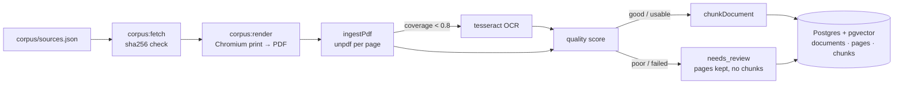

# Walkthroughs

One file per phase, written while the code is fresh. Each component answers the same six questions: what it does, how it works, why it's built this way, how it fails, what I'd change, and what an interviewer is likely to ask.

The answers under "Likely questions" are a starting point. Rewrite them in your own words: an answer you can't say without reading it isn't ready yet.

| Phase                                   | Covers                                                                                                                     |
| --------------------------------------- | -------------------------------------------------------------------------------------------------------------------------- |
| [0: Cleanup](phase-0.md)                | Repo hygiene, ESM, config, error handling, CI, decision records                                                            |
| [1: Corpus and foundations](phase-1.md) | Corpus pinning, EDGAR rendering, PDF ingestion, OCR, quality score, chunker, Postgres schema, re-indexing, known-bug tests |

## How the pieces connect (end of Phase 1)

The rule that runs through all of it: **a fact is only as good as the page it cites.** Every design choice in Phase 1 protects page numbers: per-page extraction, rendering that matches the printed copy, fingerprints that catch pagination drift, chunks that carry page ranges, and page text stored separately from chunks so quotes are checked against the page, not against a chunk.
